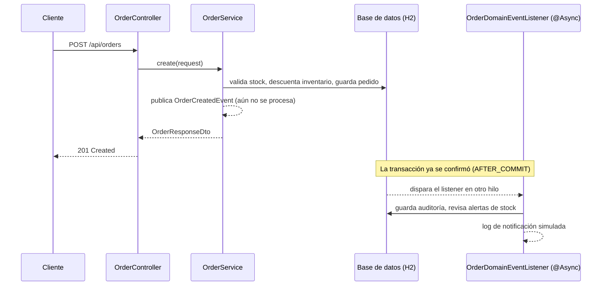

# RetailOrder Service

Microservicio de ejemplo (proyecto integrador del curso) para un negocio de retail: maneja el
catálogo de productos, el inventario y los pedidos de los clientes. Está hecho con **Java 21** y
**Spring Boot 4.1.2**, con base de datos **H2 en memoria**, documentación interactiva con
**Swagger/OpenAPI** y una suite de pruebas automatizadas en **Postman**.

Este documento es, sobre todo, una explicación de **por qué el proyecto está organizado así**:
qué es cada carpeta, qué responsabilidad tiene, y por qué separar las cosas de esta manera evita
problemas más adelante.

---

## 1. Arrancar el proyecto en 30 segundos

```bash
./mvnw spring-boot:run
```

- API disponible en `http://localhost:8080`
- Swagger UI (explorar/probar endpoints a mano): `http://localhost:8080/swagger-ui/index.html`
- Consola de la base de datos H2: `http://localhost:8080/h2-console` (JDBC URL: `jdbc:h2:mem:retaildb`, usuario `sa`, sin contraseña)
- Colección de pruebas Postman: carpeta [`postman/`](postman/README.md)

La base de datos se repuebla sola al arrancar (ver sección de H2 más abajo), así que no necesitas
crear productos a mano para empezar a probar.

---

## 2. La arquitectura: capas, y por qué existen

El proyecto sigue una **arquitectura en capas** (layered architecture). La idea central es simple:
**cada capa tiene una única responsabilidad y solo le habla a la capa de abajo**. El controller no
sabe nada de SQL, el repositorio no sabe nada de HTTP, y el modelo de base de datos nunca sale
"crudo" por la API. Esto es lo que te permite, por ejemplo, cambiar cómo se ve una respuesta JSON
sin tocar una sola línea de la base de datos, o cambiar una regla de negocio sin tocar el
controller.

```
HTTP request
    │
    ▼
controller/   → traduce HTTP ⇄ DTOs. No tiene lógica de negocio.
    │
    ▼
service/      → las reglas de negocio viven aquí. Orquesta repositorios y valida.
    │
    ▼
repository/   → habla con la base de datos (JPA/Hibernate). No sabe nada de HTTP.
    │
    ▼
model/        → las entidades: lo que efectivamente se guarda en la base de datos.
```

Y cruzando todo esto, dos capas transversales:

- **`exception/`** — qué pasa cuando algo sale mal, en cualquier capa.
- **`event/` + `config/`** — lo que ocurre *después* de que la respuesta ya se envió (async).

A continuación, cada carpeta con detalle.

### `model/` — las entidades JPA (lo que vive en la base de datos)

Son las clases anotadas con `@Entity` (`Product`, `Order`, `OrderItem`, `AuditLog`) más el enum
`OrderStatus`. Cada una mapea 1-a-1 a una tabla de la base de datos (Hibernate genera el `CREATE
TABLE` automáticamente a partir de estas clases, gracias a `spring.jpa.hibernate.ddl-auto=update`).

Cosas no obvias que vale la pena explicar:

- **`Product.active` + `Product.version`**: `active` es la "baja lógica" (soft delete) — en vez de
  borrar la fila, la marcamos como inactiva, para no perder el historial de pedidos que la
  referencian. `version` es para el **bloqueo optimista**: si dos pedidos intentan descontar stock
  del mismo producto al mismo tiempo, Hibernate detecta el conflicto y el segundo falla con un 409
  en vez de dejar el stock en un estado inconsistente.
- **`Order.stockReverted`**: una bandera para que cancelar el mismo pedido dos veces no devuelva el
  stock dos veces. Es un detalle de concurrencia/idempotencia, no algo que se vea en un diagrama de
  clases típico, pero es importante para la integridad de los datos.
- **`OrderItem`** es la tabla intermedia entre `Order` y `Product` (relación "muchos a uno" con
  Product, "uno a muchos" desde Order) — y además guarda el `unitPrice` del momento de la compra,
  no el precio actual del producto. Si no hiciera esto, y el precio del producto cambiara después,
  el historial de pedidos mentiría sobre cuánto pagó el cliente.

### `dto/` — lo que realmente viaja por la API (nunca las entidades)

Un DTO (Data Transfer Object) es una clase simple que representa la forma de una petición o
respuesta HTTP. **Nunca devolvemos una entidad JPA directamente** en la API. ¿Por qué molestarse en
tener dos clases que a veces se parecen tanto (`Product` y `ProductResponseDto`)?

1. **Desacoplar el contrato de la API del esquema de la base de datos.** Si mañana agregas una
   columna interna a `Product` (por ejemplo, un campo de auditoría), no quieres que aparezca
   automáticamente en la respuesta JSON sin que lo decidas explícitamente.
2. **Evitar problemas de serialización con relaciones JPA.** `Order` tiene una lista de
   `OrderItem`, que tiene un `Order` de vuelta (relación bidireccional) — serializar eso tal cual
   con Jackson puede generar un bucle infinito o cargar de más. El DTO (`OrderResponseDto` +
   `OrderItemResponseDto`) define exactamente qué campos planos quieres mostrar.
3. **Validación de entrada centralizada y explícita.** Los DTOs de request (`ProductRequestDto`,
   `OrderRequestDto`, `OrderItemRequestDto`) llevan las anotaciones de Bean Validation
   (`@NotBlank`, `@Positive`, `@DecimalMin`, etc.). Son el único lugar donde se valida "la forma"
   de lo que entra, antes de que le llegue algo inválido al service.

Casi todos son `record` de Java — son inmutables y no necesitan getters/setters escritos a mano,
perfecto para algo que solo transporta datos y no tiene comportamiento.

`ApiErrorDto` es el formato estándar de **todas** las respuestas de error (ver `exception/` más
abajo): siempre `timestamp`, `status`, `error`, `message`, sin importar qué falló.

### `repository/` — el puente hacia la base de datos

Son interfaces (`ProductRepository`, `OrderRepository`, `AuditLogRepository`) que extienden
`JpaRepository`. No escribimos SQL a mano para los casos simples: Spring Data JPA genera la
implementación en tiempo de ejecución solo con el nombre del método (por ejemplo,
`findByEntityTypeAndEntityIdOrderByCreatedAtDesc`).

Para los filtros opcionales de productos y pedidos (`category`, `minPrice`, `maxPrice`,
`status`, `customerId`) usamos `JpaSpecificationExecutor` en vez de escribir un método por cada
combinación posible de filtros — una `Specification` arma el `WHERE` dinámicamente solo con los
filtros que el usuario realmente mandó.

### `service/` — donde vive la lógica de negocio real

Esta es la capa más importante para entender el "por qué" del sistema. Las reglas del negocio
(no las reglas de HTTP, no las reglas de SQL) viven aquí:

- `ProductService`: valida que el precio sea positivo, aplica la baja/reactivación lógica, arma los
  filtros dinámicos.
- `OrderService`: valida stock disponible, calcula el total, descuenta inventario, controla qué
  transiciones de estado son válidas (`PENDIENTE → EN_PROCESO → ENVIADO`), y en la cancelación
  revierte el stock **solo si no se había revertido ya**.
- `AuditService` / `AuditLogService`: guardan y consultan el registro de auditoría.

Todos los métodos que modifican datos están dentro de `@Transactional`: si algo falla a mitad de
camino (por ejemplo, el segundo producto de un pedido no tiene stock suficiente), **toda la
operación se revierte**, incluyendo el descuento de stock que ya se había hecho al primer producto.
Esto es justo lo que el enunciado del curso pide como "operaciones atómicas".

El controller nunca decide reglas de negocio — solo llama al service y traduce el resultado a
HTTP. Esto permite, por ejemplo, reusar `OrderService.cancel()` desde otro lugar (un job, un test)
sin pasar por una petición HTTP.

### `controller/` — la puerta de entrada HTTP

Son las clases `@RestController` (`ProductController`, `OrderController`, `AuditLogController`).
Su trabajo es mínimo y mecánico a propósito:

1. Recibir la petición HTTP (path variables, query params, body).
2. Pedirle al service que haga el trabajo real.
3. Traducir el resultado a un código HTTP (`201 Created` con `Location`, `204 No Content`, `200
   OK`, etc.) y a un DTO de respuesta.

Que sean "tontos" es intencional: si la lógica de negocio estuviera aquí, sería imposible de
reusar o probar sin levantar un servidor HTTP completo.

### `exception/` — manejo centralizado de errores

En vez de poner `try/catch` en cada controller, definimos excepciones de dominio con nombre
explícito (`RecursoNoEncontradoException`, `StockInsuficienteException`, `PrecioInvalidoException`,
`EstadoInvalidoException`) y un único punto que las atrapa a todas: `GlobalExceptionHandler`
(anotado con `@RestControllerAdvice`, que intercepta excepciones lanzadas desde cualquier
controller de la app).

La ventaja: cada service simplemente hace `throw new StockInsuficienteException(...)` cuando algo
no se cumple, sin preocuparse por el código HTTP ni el formato de la respuesta — eso se decide en
un solo lugar, de forma consistente (`ApiErrorDto`: siempre el mismo formato, sin importar qué
falló). El handler también atrapa cosas que no son "de negocio" pero igual deben responder bonito:
JSON mal formado, un parámetro con el tipo equivocado en la URL, una violación de restricción única
en la base de datos (SKU duplicado), o un conflicto de bloqueo optimista.

### `event/` — lo que pasa *después* de responder al cliente

Esta carpeta es la respuesta al requisito de "procesamiento síncrono vs. asíncrono" del curso.
La idea: cuando se crea o cancela un pedido, hay cosas que el cliente **no debería tener que
esperar** para recibir su respuesta — notificarlo, dejar un registro de auditoría, revisar si hay
que alertar por bajo stock. Ninguna de esas tres cosas debe bloquear ni poner en riesgo la
respuesta HTTP.

Cómo funciona en este proyecto:

1. `OrderService` (y `ProductService`, cuando cambia el stock) terminan su trabajo síncrono normal
   y, justo antes de devolver la respuesta, publican un evento (`OrderCreatedEvent`,
   `OrderCancelledEvent`, `StockChangedEvent`) — no hacen el trabajo asíncrono ellos mismos.
2. `OrderDomainEventListener` escucha esos eventos con dos anotaciones clave:
   - `@TransactionalEventListener(phase = AFTER_COMMIT)`: solo reacciona **después** de que la
     transacción de base de datos ya se confirmó. Si reaccionara antes, un hilo asíncrono podría
     leer datos que todavía no existen de verdad en la base de datos.
   - `@Async`: hace que el método se ejecute en otro hilo (ver `config/AsyncConfig.java`), para que
     el hilo que atiende la petición HTTP no tenga que esperarlo.
3. Ahí se registra la notificación simulada (por ahora solo un log — no hay proveedor de correo/SMS
   real conectado), se guarda la auditoría en la tabla `audit_logs`, y se revisa si el stock cayó
   por debajo del umbral mínimo para generar una alerta.

No usamos un *message broker* externo (Kafka, RabbitMQ, etc.) porque para el alcance de este
proyecto sería infraestructura de más: el pool de hilos de Spring (`@Async`) ya resuelve el
requisito de "no bloquear al usuario" sin montar un sistema aparte.

### `config/` — ajustes transversales de Spring

Clases `@Configuration` que configuran algo que afecta a toda la aplicación, no a un endpoint en
particular:

- `PersistenceConfig`: le dice a Spring dónde buscar las entidades (`@EntityScan`) y los
  repositorios (`@EnableJpaRepositories`) — necesario porque la clase principal
  (`RetailOrderServiceApplication`) vive en un paquete distinto al resto del código.
- `AsyncConfig`: define el pool de hilos que usan los métodos `@Async` del paquete `event/`.
- `OpenApiConfig`: metadatos (título, descripción) que aparecen en Swagger UI.

---

## 3. H2 — la base de datos

**H2** es una base de datos relacional escrita en Java que puede correr **en memoria** (los datos
viven en RAM mientras la aplicación está corriendo, y desaparecen al apagarla). Se usa muchísimo en
proyectos de aprendizaje y para pruebas automatizadas porque:

- No hay que instalar ni configurar nada: arranca junto con la aplicación.
- Cada vez que reinicias la app, empiezas con una base de datos limpia — ideal para probar sin
  preocuparte por "ensuciar" datos de pruebas anteriores.
- Hibernate la usa para generar automáticamente las tablas a partir de las entidades
  (`spring.jpa.hibernate.ddl-auto=update`), así que no escribimos ningún script de creación de
  esquema a mano.

Para que no tengas que crear productos manualmente cada vez que arrancas, `data.sql`
(`src/main/resources/data.sql`) inserta un catálogo de ejemplo en cada arranque — después de que
Hibernate crea las tablas (`spring.jpa.defer-datasource-initialization=true` controla ese orden).

También tiene una consola web (`/h2-console`) para que puedas ejecutar SQL directamente y ver las
tablas mientras la app está corriendo — útil para depurar sin tener que escribir un endpoint nuevo
solo para mirar un dato.

**Importante:** H2 en memoria es para desarrollo y pruebas, no para producción — ahí normalmente se
usaría PostgreSQL, MySQL u otro motor que persista datos en disco de verdad.

---

## 4. Swagger / OpenAPI — documentación interactiva de la API

**OpenAPI** es un estándar para describir una API REST (qué endpoints existen, qué reciben, qué
devuelven, qué errores pueden pasar) en un documento JSON/YAML, de forma que tanto humanos como
herramientas puedan entenderla sin leer el código fuente. **Swagger UI** es la interfaz web que lee
ese documento y te deja **explorar y probar los endpoints desde el navegador**, con formularios
generados automáticamente a partir de los DTOs.

En este proyecto no escribimos el documento OpenAPI a mano: la librería `springdoc-openapi` lo
genera automáticamente leyendo los controllers, los DTOs y sus anotaciones de validación. Por eso,
si agregas un endpoint nuevo, Swagger UI se actualiza solo, sin que tengas que mantener
documentación por separado.

- Documento OpenAPI en crudo: `http://localhost:8080/v3/api-docs`
- Interfaz visual: `http://localhost:8080/swagger-ui/index.html`

---

## 5. Postman — pruebas automatizadas de extremo a extremo

Mientras que Swagger UI es para **probar a mano, una petición a la vez**, la colección de Postman
(`postman/RetailOrderService.postman_collection.json`) es para **automatizar** el flujo completo:
crear un producto, hacer un pedido, verificar que el stock bajó, cancelar, verificar que el stock
volvió, provocar a propósito los casos de error (stock insuficiente, recursos inexistentes,
cancelaciones/reactivaciones duplicadas), y comprobar que hasta las tareas asíncronas (auditoría,
alertas) realmente ocurrieron — todo con aserciones automáticas (`pm.test(...)`), no revisando a
ojo cada respuesta.

Se puede correr desde la app de Postman (**Collection Runner**, un clic) o desde la terminal con
**Newman** (el mismo motor de Postman, pero como herramienta de línea de comandos — útil para
integrarlo en CI más adelante). El detalle completo de cómo importarla y correrla está en
[`postman/README.md`](postman/README.md).

---

## 6. Diagramas

El modelo de clases y el diagrama entidad-relación completos (en formato Mermaid) están en
[`docs/DIAGRAMS.md`](docs/DIAGRAMS.md).

Para cerrar, así se ve el recorrido completo de una petición que crea un pedido — la parte
síncrona (lo que el cliente espera) y la parte asíncrona (lo que sigue pasando después, sin que el
cliente tenga que esperarlo):



El cliente nunca espera por el bloque de abajo (auditoría, alertas, notificación) — eso es
exactamente lo que pide la parte de "procesamiento asíncrono" del proyecto integrador.
