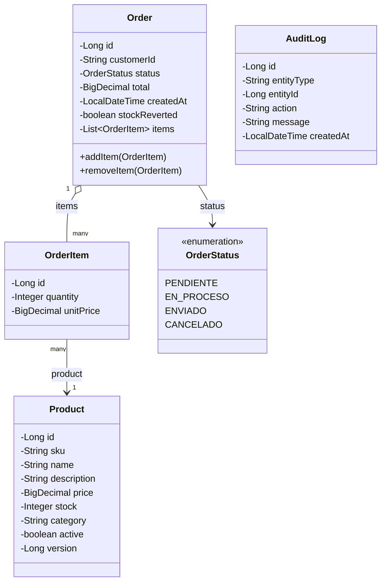
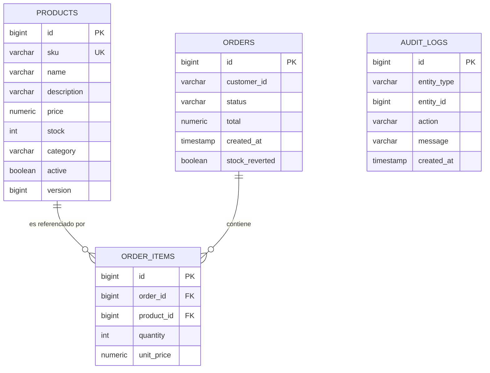

# Diagramas — RetailOrder Service

## Diagrama de clases (modelo de dominio)

`AuditLog` es independiente del modelo transaccional: no tiene relación JPA directa con `Order`/`Product`, se enlaza por `entityType` + `entityId` (referencia débil), ya que solo registra evidencia de las tareas asíncronas (ver `CLAUDE.md`, sección de procesamiento asíncrono).

## Diagrama entidad-relación (DER)

`audit_logs` no tiene clave foránea hacia `products`/`orders`: se escribe de forma asíncrona y desacoplada (ver justificación en `CLAUDE.md`), por lo que modelarla con FK obligaría a acoplar el escritor asíncrono a la existencia síncrona del registro padre en el instante de guardado.
